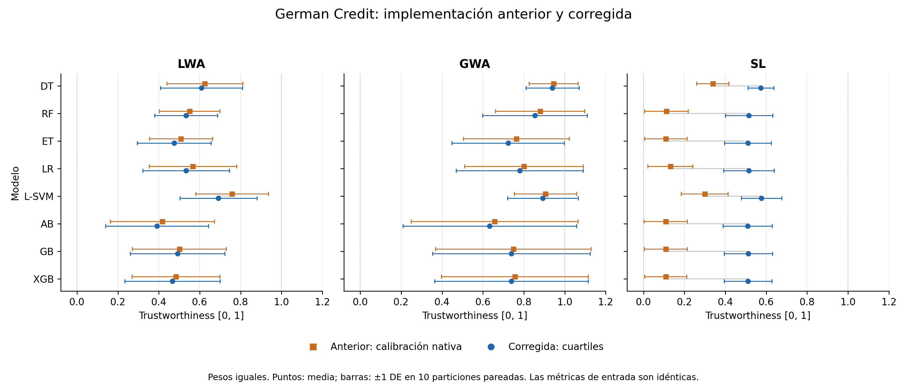

# TWEEF

Trustworthiness Estimation and Enhancement Framework for Machine Learning Models.

## Aggregation correction and German benchmark

Scalar `TrustworthinessEstimator.compute_metric()` and batch `fit()/transform()`
use the same selected operator, calibration, importance weights, and score scale.
`transform()` keeps the original row index and continuous linguistic diagnostics
in the metric columns; `Trustworthiness` contains the selected operator's score.
Per-row `AggregationResult` objects are available in `aggregation_results_`.

Empirical calibration is frozen at `[minimum, P25, P50, P75, maximum]`, using
linear quantile interpolation independently for each metric. Repeated crests
are allowed. A completely constant reference cannot identify a relative scale
and raises an explicit error instead of inventing thresholds. Explicit expert
crests and the existing fixed defaults remain supported.

Subjective Logic now averages Dirichlet evidence with the assigned metric
importance weights. With prior weight `W=2`, each non-dogmatic opinion gives
`r_i=2*b_i/u_i`, `s_i=2*d_i/u_i`; evidence is averaged with the normalized weights
and mapped back using `b=r/(2+r+s)`, `d=s/(2+r+s)`, `u=2/(2+r+s)`.
The result is projected as `b + alpha*u`. This is an importance-weighted extension
of averaging fusion, **not** the previous cumulative consensus or the standard
confidence-weighted belief fusion. Zero weights contribute no evidence. Vacuous
opinions contribute zero evidence; positive-weight dogmatic opinions dominate
finite evidence and are averaged among themselves using renormalized importance
weights (a common-rate zero-uncertainty limit).
The distinction between averaging and cumulative fusion is discussed in
[Multi-Source Fusion Operations in Subjective Logic](https://arxiv.org/abs/1805.01388).

GWA accepts `gwa_hesitation=0.0` as a scalar or a partial mapping by metric name.
For the favorable linguistic expectation `z`, the TWEEF mapping is
`mu=(1-h)*z`, `nu=(1-h)*(1-z)`, `pi=h`. Unspecified mapping entries have zero
hesitation. The default preserves the previous GWA with the same calibration.
Input and aggregated hesitations are included in `AggregationResult.details`.
Complete uncertainty returns the neutral score `0.5`; uncertainty and the
relative score `mu/(mu+nu)` are reported separately. A greater hesitation does
not necessarily decrease this relative score.
The Gaussian aggregation formula follows
[Ünver (2025)](https://doi.org/10.1007/s00357-025-09507-4); the proportional
hesitation mapping above is the explicit TWEEF adaptation.

The reproducible runner `experiments/german_aggregation.py` evaluates DT, RF, ET,
Linear Regression (binary threshold 0.5), Linear SVM, AdaBoost SAMME.R, Gradient
Boosting and XGBoost on all 1,000 German records. It uses Accuracy, Equal
Opportunity and loss-based Effective Complexity. Each seed uses identical
60/20/20 train/calibration/test partitions stratified by target and gender, with
preprocessing fitted only on training data. The enhancement/surrogate pipeline
does not participate in this aggregation benchmark.

Create a separate environment and preserve a baseline source snapshot:

```sh
python3 -m venv .venv-paper
.venv-paper/bin/python -m pip install --upgrade pip
.venv-paper/bin/python -m pip install -e . -r experiments/requirements-german.txt
mkdir -p /tmp/tweef-baseline-a36fe25
git archive a36fe25 | tar -x -C /tmp/tweef-baseline-a36fe25
```

On macOS, if XGBoost cannot locate OpenMP, the installed scikit-learn wheel's
bundled runtime can be used without a system installation:

```sh
export DYLD_FALLBACK_LIBRARY_PATH="$(.venv-paper/bin/python -c 'import pathlib, sklearn; print(pathlib.Path(sklearn.__file__).parent / ".dylibs")')"
```

Run all repetitions, reusing cached metric matrices when available:

```sh
.venv-paper/bin/python experiments/german_aggregation.py \
  --baseline-root /tmp/tweef-baseline-a36fe25 \
  --seeds 0 1 2 3 4 5 6 7 8 9 \
  --output experiments/results/german --reuse-metrics
.venv-paper/bin/python experiments/summarize_german.py \
  --input experiments/results/german
```

The saved results include data/source checksums, splits, model parameters,
environment versions, metric matrices, crests, aggregation details, paired score
differences, rankings and API consistency checks. `legacy_native` executes the
unmodified baseline's P20/P40/P60 scalar calibration and quartile batch path;
`legacy_quartiles` supplies identical quartile crests to both baseline paths to
isolate operator changes. Nonuniform legacy batch weights are assigned explicitly
to its existing `.weights` attribute because its `fit()` has no weight argument.
`corrected` executes this branch with both interfaces sharing one calibrator.

The current probability-based Effective Complexity helper uses absolute soft-label
cross-entropy rather than degradation from the unrestricted model. When the
reference entropy already exceeds the loss threshold `0.05`, its score is
necessarily zero. The runner records this condition and uses the exact entropy
lower bound to avoid redundant computations; the underlying metric is unchanged
in this correction. This limits conclusions about interpretability and must be
addressed before treating this benchmark as final paper evidence.

The saved ten-seed run contains 80 trained models and 45,600 paired API result
rows, with no failed configurations. Batch/scalar scores are exactly equal in
the corrected implementation. SL responds to importance weights in all 80
seed/model cases, compared with none in either legacy scenario. With full GWA
hesitation, all 80 cases return score 0.5 and aggregated hesitation 1.

| Operator | Mean paired score change vs legacy native | Change with identical quartile calibration |
|---|---:|---:|
| LWA | -0.027083 | 0 |
| GWA, zero hesitation | -0.019092 | within 2.1e-16 per case |
| SL | +0.363882 | -0.006023 |

These are descriptive changes on the same metric inputs, not improvements in
predictive performance or evidence that an operator is superior. Most of the
large SL change comes from recalibration: the old EC crests often produce
zero uncertainty, giving zero-EC opinions dogmatic influence. Under identical
quartiles, SL's mean fusion change is much smaller. Effective Complexity was
zero in every test repetition for RF, ET, AB, GB and XGB, and in 4/10 for LR.

See the [per-model comparison](experiments/results/german/comparison_by_model.csv)
for means, standard deviations and paired differences, and the
[audit summary](experiments/results/german/audit_summary.json) for API consistency,
weight sensitivity, hesitation, rankings and metric limitations.



TWEEF is a Python framework for estimating and improving the trustworthiness of
binary classification models. It evaluates three trust dimensions:

- Performance
- Fairness
- Interpretability

The framework computes metric values for an initial model, applies fairness and
interpretability processing, evaluates the final model, and reports both the final
trustworthiness summary and the trade-offs between trust dimensions.

## Publication

This framework was published in the following paper:

Ugalde, J., Salas, R., Torres, R., Velandia, D., Bariviera, A. F., Estevez, P. A.,
& Godoy, M. P. (2026). TWEEF: Trustworthiness Estimation and Enhancement
Framework for Machine Learning Models. *Applied Sciences*, *16*(2), 1077.
[Read the paper](https://www.mdpi.com/2076-3417/16/2/1077)

## Installation

Install TWEEF from the repository:

```bash
pip install git+https://github.com/ugald80/TWEEF.git@v0.0.3
```

For local development:

```bash
python3 -m pip install -e ".[all,dev]"
```

Core requirements:

- Python >= 3.9
- scikit-learn

Optional dependencies are grouped by capability:

```bash
pip install "tweef[fairness]"
pip install "tweef[interpretability]"
pip install "tweef[all]"
```

If an existing environment upgraded NumPy to 2.x and reports binary compatibility
errors, reinstall the project constraints:

```bash
python3 -m pip install --force-reinstall -e ".[all,dev]"
```

## User Manual

### 1. Prepare Your Data

TWEEF expects a pandas `DataFrame` for `X` and a pandas `Series` for `y`.
The protected attributes used for fairness analysis must be present as columns in
`X`.

```python
import pandas as pd

X = pd.DataFrame(...)
y = pd.Series(..., name="target")
```

TWEEF currently targets binary classification problems.

### 2. Define Fairness Groups

Use `FairnessGroup` to define protected and unprotected groups. Each group is
defined as a dictionary where the key is a column in `X` and the value is the list
of values belonging to that group.

```python
from TWEEF.UtilsFairnessGroup import FairnessGroup

protected_groups = FairnessGroup([
    {"gender_female": [1.0]},
])

unprotected_groups = FairnessGroup([
    {"gender_female": [0.0]},
])

protected_classes = [1.0]
```

### 3. Select Metrics

Metrics are grouped into performance, fairness, and interpretability dimensions.
Metric weights must sum to `1.0`.

```python
from TWEEF.Constants import METRICS
from TWEEF.Metrics import MetricList

metrics = MetricList()
metrics.add_metric(METRICS.PERFORMANCE.ACCURACY, weight=1 / 3, goal=0.8)
metrics.add_metric(METRICS.FAIRNESS.EQUAL_OPPORTUNITY, weight=1 / 3, goal=0.8)
metrics.add_metric(
    METRICS.INTERPRETABILITY.EFFECTIVE_COMPLEXITY,
    weight=1 / 3,
    goal=0.8,
)
```

Supported performance metrics include:

- `Accuracy`
- `Precision`
- `Recall`
- `F1Score`
- `Specificity`
- `Negative Predictive Value`

Supported fairness metrics include:

- `Statistical Parity`
- `Treatment Equality`
- `Equalized Odds`
- `equal Opportunity`

Supported interpretability metrics include:

- `Monotonicity`
- `Non Sensitivity`
- `Effective Complexity`

### 4. Create and Fit a TWEEF Classifier

`TrustworthyClassifier` follows the standard scikit-learn estimator contract:
configure it in the constructor, then call `fit(X, y)`.

```python
from sklearn.tree import DecisionTreeClassifier
from TWEEF import TrustworthyClassifier

model = DecisionTreeClassifier(random_state=0)

classifier = TrustworthyClassifier(
    given_classifier=model,
    protected_groups=protected_groups,
    unprotected_groups=unprotected_groups,
    protected_classes=protected_classes,
    metrics=metrics,
    aggregation="lwa",
    test_size=0.3,
    random_state=0,
)

classifier.fit(X, y)
predictions = classifier.predict(X_test)
```

The model passed in `given_classifier` can be any compatible scikit-learn
classifier.

### 5. Read the Outputs

After `fit`, TWEEF exposes the main reports as attributes:

```python
classifier.final_report_
classifier.tradeoffs_
classifier.diagnosis_
classifier.component_scores_
classifier.trustworthiness_score_
```

`final_report_` is the main summary table. It shows the diagnosis and final metric
values by stage, dimension, and metric.

```python
print(classifier.final_report_)
```

`tradeoffs_` shows directional trade-offs between trust dimensions:

```python
print(classifier.tradeoffs_)
```

The directional trade-off rows include:

- `performance_vs_fairness`
- `performance_vs_interpretability`
- `fairness_vs_performance`
- `fairness_vs_interpretability`
- `interpretability_vs_performance`
- `interpretability_vs_fairness`

Each row reports the diagnosis value, final value, absolute change, relative
change, reference-dimension change, variation ratio, relative cost, and relation
type.

`diagnosis_` keeps the initial trustworthiness assessment of the input model.
`component_scores_` keeps the detailed metric table used to build `final_report_`.
`trustworthiness_score_` stores the final aggregated trustworthiness score.

### 6. Configure Trust Aggregation

TWEEF exposes the aggregation operators described by the framework:

- `lwa`: Linguistic Weighted Average.
- `gwa`: Gaussian Weighted Aggregation.
- `sl`: Subjective Logic aggregation.

Select the operator with:

```python
classifier = TrustworthyClassifier(
    given_classifier=model,
    protected_groups=protected_groups,
    unprotected_groups=unprotected_groups,
    protected_classes=protected_classes,
    metrics=metrics,
    aggregation="gwa",
)
```

By default, TWEEF reports trustworthiness in the normalized `[0,1]` scale. For
paper-style linguistic reporting, use the `[-2,2]` scale:

```python
classifier = TrustworthyClassifier(
    given_classifier=model,
    protected_groups=protected_groups,
    unprotected_groups=unprotected_groups,
    protected_classes=protected_classes,
    metrics=metrics,
    trustworthiness_score_scale="linguistic",
)
```

Accepted values are:

- `normalized` for `[0,1]`
- `linguistic` for `[-2,2]`

### 7. Configure Effective Complexity

`Effective Complexity` supports two calculation modes:

- `attribution`: fast proxy based on the cumulative mass of feature attributions.
- `loss`: original definition based on the expected loss after restricting the
  model to the top-k attributed features.

Use the original loss-based definition with:

```python
classifier = TrustworthyClassifier(
    given_classifier=model,
    protected_groups=protected_groups,
    unprotected_groups=unprotected_groups,
    protected_classes=protected_classes,
    metrics=metrics,
    effective_complexity_mode="loss",
    effective_complexity_loss_threshold=0.05,
    effective_complexity_repeats=3,
)
```

## Logging

TWEEF uses standard Python logging. Applications can configure logs once at
startup:

```python
from TWEEF import TWEEFLogger

TWEEFLogger.configure(level="INFO")
```

The default format is:

```text
YYYY-MM-DD HH:MM:SS | LEVEL | module_or_class.function | message
```

## Paper Experiments Demo

The experiments from the published TWEEF paper can be executed from this
repository. The reference is:

Ugalde, J., Salas, R., Torres, R., Velandia, D., Bariviera, A. F., Estevez, P. A.,
& Godoy, M. P. (2026). TWEEF: Trustworthiness Estimation and Enhancement
Framework for Machine Learning Models. *Applied Sciences*, *16*(2), 1077.
[Read the paper](https://www.mdpi.com/2076-3417/16/2/1077)

The demo script reproduces the experimental setup described in that publication.

```bash
python3 demo/paper_experiments.py --dataset all
```

By default the script uses a reproducible sample for faster development runs. To
use all available rows:

```bash
python3 demo/paper_experiments.py --dataset all --full
```

To run one dataset:

```bash
python3 demo/paper_experiments.py --dataset german
python3 demo/paper_experiments.py --dataset compas
python3 demo/paper_experiments.py --dataset adult
```

To report trustworthiness in the paper's linguistic scale:

```bash
python3 demo/paper_experiments.py --dataset all --trustworthiness-score-scale linguistic
```

To use the loss-based Effective Complexity definition:

```bash
python3 demo/paper_experiments.py --dataset german --effective-complexity-mode loss
```

The demo requires the optional fairness and interpretability dependencies:

```bash
python3 -m pip install -e ".[all]"
```

## Development

Run the test suite with:

```bash
python3 -m pytest -q
```

Some integration tests are opt-in because they require datasets and optional
dependencies:

```bash
TWEEF_RUN_INTEGRATION=1 python3 -m pytest test/test_trustworthy_classifier.py
```
