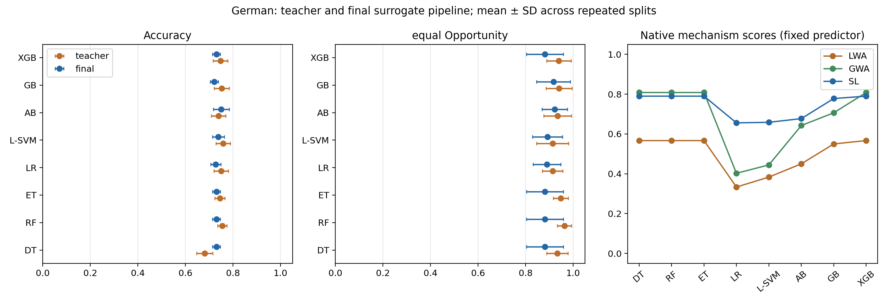
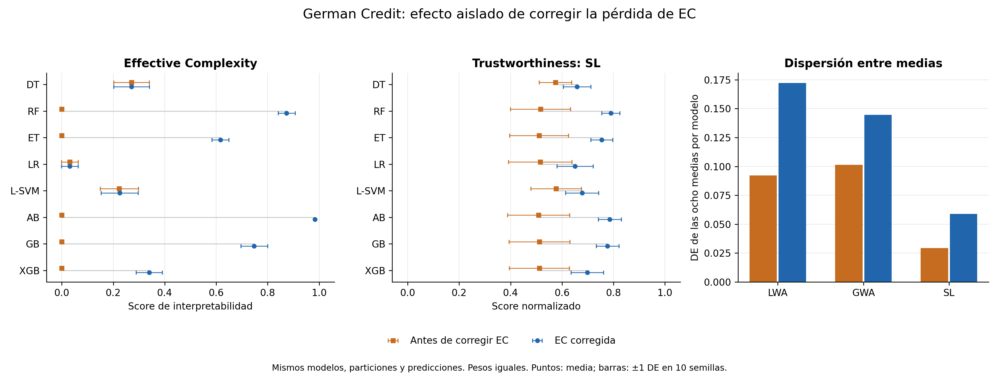
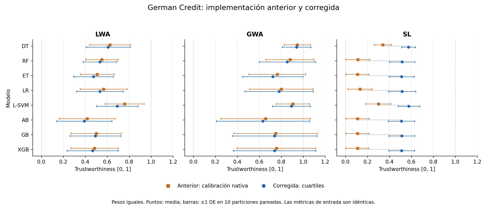

# Experimental protocols and results

All commands below run from the repository root.

## German: final-surrogate experiment

Run the complete new protocol in a separate directory:

```sh
.venv-paper/bin/python test/experiments/german_final_surrogate.py \
  --output test/experiments/results/german_final_surrogate_new
```

On macOS, use the OpenMP environment variable described in the installation notes
below if required by the XGBoost wheel. A smaller smoke run is:

```sh
.venv-paper/bin/python test/experiments/german_final_surrogate.py \
  --output /tmp/tweef-final-surrogate-smoke --seeds 0 --models DT RF \
  --candidate-rounds 25 50 --reference-cv 3 --ec-repeats 1
```

The full run retains all 1,000 records, the paper's eight teacher configurations
and seeds 0–9. Each seed has the same 600/200/200 train/calibration/test split as
the earlier benchmark. Two additive EBM candidates have fixed budgets of 100 and
500 maximum rounds, one outer bag and one job; these are explicit experimental
settings, not EBM defaults. There are 160 final candidate fits plus internal CV
fits. Postprocessing is explicitly enabled for the main run.

Within each seed, training-only five-fold references from every teacher/candidate
are pooled. Fold-local fairness calibration is separate from the fold used for
metric measurement. Final fairness calibration uses the external calibration
partition. No candidate selection or reference fitting uses test.

Two analyses reuse the same fitted candidates and cached metric matrices:

1. **Fixed predictor:** the 500-round candidate is evaluated by all mechanisms with
   identical metrics/reference. Weight sweeps, GWA hesitation, rankings, ties and
   rank agreement describe mechanism behavior.
2. **Complete flow:** each mechanism selects the candidate with the best mean
   internal CV mechanism score before any test evaluation. Candidates, splits,
   references and budgets are identical; ties prefer the smaller budget.

`test/experiments/results/german_final_surrogate` contains the protocol/source/environment
manifest, per-seed caches, CV references, raw teacher/student/final metrics,
class-disagreement comparisons, KL metrics, fidelity, mechanism scores/rankings,
full-flow selections, predictive differences and a summary figure. Cache reuse
requires the same full protocol fingerprint and rejects incompatible output
before overwriting its manifest.

Historical results remain in `german` and `german_ec_kl`. The new experiment changes
the final predictor, EC perturbation unit, attribution fitting and calibration
reference; EC/score changes against those artifacts cannot be attributed to
aggregation alone. Accuracy/equity changes are reported with the changed protocol
made explicit. Repeated splits overlap and are descriptive evidence from one
dataset. Native mechanism scores are not interchangeable units; a higher average
score alone is not evidence of greater real trustworthiness.

### Validated results of the final-surrogate run

The completed run contains **160 final candidates, 800 internal-CV reference rows,
7,840 mechanism evaluations and 240 CV-based selection decisions**. All ten seeds
and eight teachers completed. The historical audit verifies identical external
splits and teacher predictions in all 80 comparisons. Values below are means over
ten repeated splits for the fixed 500-round EBM candidate; the final column uses
KL with tolerance 0.05 nats. SDs and explicit label-loss comparisons are available
in [`metrics_by_model.csv`](results/german_final_surrogate/metrics_by_model.csv).

| Teacher | Teacher accuracy | Base student accuracy | Final accuracy | Teacher EO | Final EO | Final EC (KL) |
|---|---:|---:|---:|---:|---:|---:|
| DT | 0.6810 | 0.7585 | 0.7300 | 0.9335 | 0.8810 | 0.850 |
| RF | 0.7550 | 0.7585 | 0.7300 | 0.9635 | 0.8810 | 0.850 |
| ET | 0.7445 | 0.7585 | 0.7300 | 0.9480 | 0.8810 | 0.850 |
| LR | 0.7495 | 0.7440 | 0.7270 | 0.9135 | 0.8900 | 0.285 |
| L-SVM | 0.7580 | 0.7575 | 0.7380 | 0.9135 | 0.8920 | 0.285 |
| AB | 0.7390 | 0.7575 | 0.7505 | 0.9350 | 0.9220 | 0.300 |
| GB | 0.7525 | 0.7415 | 0.7210 | 0.9405 | 0.9175 | 0.760 |
| XGB | 0.7470 | 0.7585 | 0.7300 | 0.9400 | 0.8810 | 0.850 |

The mean final Accuracy improves over DT and AdaBoost teachers and decreases for
the other six. Final hard-label EO decreases on average for all eight. Thus this
run validates execution and exposes tradeoffs; it does not demonstrate a general
fairness improvement. In the 80 fixed-candidate cases, **10** miss the diagnostic
teacher/student agreement target of 0.8, **38** miss held-out EO of 0.9, and **28**
have a calibrated postprocessing mixing rate outside [0,1]. The effective rate is
saturated as in AIF360's comparison rule and the unattainability is reported.
These three diagnostics describe different conditions. The postprocessor targets
generalized FNR on calibration data, which neither guarantees a held-out hard-label
EO threshold nor causes TWEEF to replace the student with its teacher.

DT, RF, ET and XGB yield exactly the same final probabilities and labels within
each of the ten seeds at this fixed student budget. Their base-student class
predictions also coincide. Distillation uses teacher predictions on training
inputs; teachers fitting the same training labels can produce the same student.
The four rows therefore do not represent four independent distinct final predictors.

With uniform weights, the native mechanism means are:

| Teacher | LWA | GWA | SL |
|---|---:|---:|---:|
| DT | 0.5667 | 0.8083 | 0.7899 |
| RF | 0.5667 | 0.8083 | 0.7899 |
| ET | 0.5667 | 0.8083 | 0.7899 |
| LR | 0.3333 | 0.4024 | 0.6557 |
| L-SVM | 0.3833 | 0.4446 | 0.6586 |
| AB | 0.4500 | 0.6425 | 0.6772 |
| GB | 0.5500 | 0.7064 | 0.7780 |
| XGB | 0.5667 | 0.8083 | 0.7899 |

These are native mechanism outputs with different meanings. Their numerical sizes
cannot establish comparative quality. In complete-flow selection:

| Mechanism | Selects 100 rounds | Selects 500 rounds | Exact CV ties | Mean test accuracy | Mean test EO |
|---|---:|---:|---:|---:|---:|
| LWA | 69 | 11 | 45 | 0.7315 | 0.8952 |
| GWA | 60 | 20 | 35 | 0.7311 | 0.8946 |
| SL | 71 | 9 | 35 | 0.7318 | 0.8960 |

All three mechanisms choose the same candidate in 66 of 80 teacher/seed cases.
Exact score ties prefer the 100-round budget. The small differences in average
held-out outcomes are descriptive and do not establish superiority.

EC permutes the 20 original predictor variables while keeping sensitive group
metadata fixed for each observation. With group-dependent postprocessing, this is
**EC conditional on the fixed group**; it does not measure sensitivity to an
additional group input. Recomputing group membership from a perturbed status
variable would define a different intervention and a different experiment.

See the [machine-readable interpretation](results/german_final_surrogate/interpretation.json),
[full-flow decisions](results/german_final_surrogate/full_flow_selections.csv)
and [verification audit](results/german_final_surrogate/verification.json).

The complete optional-dependency suite passed **234 tests**, including real EBM,
fairness inference and serialization. The core environment passed **176 tests**
with nine optional tests/modules skipped. Recompute the saved-result audit without
retraining with `python test/experiments/verify_final_surrogate.py --archived-source --verify`; its
18 controls include source identity, partition provenance, CV decisions and
mechanism-score recomputation.




## Historical correction records

The following correction results describe the preserved aggregation-only protocol.

## Effective Complexity fidelity correction

Loss-based Effective Complexity now measures changes from the unrestricted model.
For probabilistic predictions it uses mean Bernoulli KL divergence
`D(p || q) = H(p,q) - H(p,p)`, with natural logarithms. Original and restricted
predictions that are identical have exactly zero loss, even if their probabilities
are uncertain. For models without `predict_proba`, loss remains the fraction of
class predictions that change. Probabilities are clipped in float64 for finite
endpoint calculations. The minimum top-k subset is accepted when mean fidelity
loss is at most the configured nonnegative tolerance, allowing only relative
floating-point rounding at the comparison boundary.

The interpretation score remains `I_EC = 1 - k/N`. A zero score is still valid
when all variables are needed. The correction removes the previous entropy floor
that could force this result even with all variables retained. The `attribution`
proxy, attribution ordering, permutations, random seeds and hard-label prediction
rule are unchanged.

The default tolerance `0.05` is **0.05 nats for KL** and a **0.05 disagreement
fraction for hard labels**. These have different units. This is fidelity to the
model's predictions, rather than loss of accuracy against true labels; comparing
the meaning of tolerances across model interfaces requires care.

Historical aggregation-only results are preserved in `test/experiments/results/german`.
The EC correction is evaluated separately in `test/experiments/results/german_ec_kl`.
Metric caches include data, source and environment fingerprints; incompatible
caches or output directories are rejected before the old manifest is overwritten.

The paired ten-seed validation of this correction trained the same eight models
on the same splits and verified identical class predictions, attributions,
Accuracy and Equal Opportunity in 160 calibration/test model-partitions.

| Model | Previous mean EC score | KL/disagreement mean EC score |
|---|---:|---:|
| DT | 0.270492 | 0.270492 |
| RF | 0 | 0.873770 |
| ET | 0 | 0.616393 |
| LR | 0.031148 | 0.031148 |
| L-SVM | 0.222951 | 0.224590 |
| AB | 0 | 0.983607 |
| GB | 0 | 0.747541 |
| XGB | 0 | 0.339344 |

The small L-SVM change occurs at the inclusive tolerance boundary. EC changes
also change its empirical crests and uncertainty, so aggregated scores can change
even for a model with unchanged EC. With equal weights, corrected SL means now
span 0.650294–0.789365, compared with 0.508892–0.577071 before this EC correction;
the standard deviation across the eight model means changes from 0.029378 to
0.058984. This is descriptive dispersion, not a significance test or a claim of
better predictive performance. The KL tolerance measures preservation of probability
distributions; it does not measure human understanding or classification accuracy.

See [EC differences by model](results/german_ec_kl/ec_comparison_by_model.csv),
[paired trustworthiness differences](results/german_ec_kl/ec_score_comparison.csv)
and the [pairing audit](results/german_ec_kl/ec_correction_summary.json).
Historical artifacts store class predictions but not per-row probability vectors;
the audit verifies their stored diagnostics, allowing 2e-7 absolute rounding error
for the old float32 entropy diagnostic (observed maximum 2.73e-8).



## Aggregation correction and German benchmark

Scalar `TrustworthinessEstimator.compute_metric()` and batch `fit()/transform()`
use the same selected operator, calibration, importance weights, and score scale.
`transform()` keeps the original row index and continuous linguistic diagnostics
in the metric columns; `Trustworthiness` contains the selected operator's score.
Per-row `AggregationResult` objects are available in `aggregation_results_`.

Empirical calibration is frozen at `[minimum, P25, P50, P75, maximum]`, using
linear quantile interpolation independently for each metric. Repeated crests
are allowed. A completely constant reference cannot identify a relative scale
and raises an explicit error instead of inventing thresholds. Explicit expert
crests and the existing fixed defaults remain supported.

Subjective Logic now averages Dirichlet evidence with the assigned metric
importance weights. With prior weight `W=2`, each non-dogmatic opinion gives
`r_i=2*b_i/u_i`, `s_i=2*d_i/u_i`; evidence is averaged with the normalized weights
and mapped back using `b=r/(2+r+s)`, `d=s/(2+r+s)`, `u=2/(2+r+s)`.
The result is projected as `b + alpha*u`. This is an importance-weighted extension
of averaging fusion, **not** the previous cumulative consensus or the standard
confidence-weighted belief fusion. Zero weights contribute no evidence. Vacuous
opinions contribute zero evidence; positive-weight dogmatic opinions dominate
finite evidence and are averaged among themselves using renormalized importance
weights (a common-rate zero-uncertainty limit).
The distinction between averaging and cumulative fusion is discussed in
[Multi-Source Fusion Operations in Subjective Logic](https://arxiv.org/abs/1805.01388).

GWA accepts `gwa_hesitation=0.0` as a scalar or a partial mapping by metric name.
For the favorable linguistic expectation `z`, the TWEEF mapping is
`mu=(1-h)*z`, `nu=(1-h)*(1-z)`, `pi=h`. Unspecified mapping entries have zero
hesitation. The default preserves the previous GWA with the same calibration.
Input and aggregated hesitations are included in `AggregationResult.details`.
Complete uncertainty returns the neutral score `0.5`; uncertainty and the
relative score `mu/(mu+nu)` are reported separately. A greater hesitation does
not necessarily decrease this relative score.
The Gaussian aggregation formula follows
[Ünver (2025)](https://doi.org/10.1007/s00357-025-09507-4); the proportional
hesitation mapping above is the explicit TWEEF adaptation.

The reproducible runner `test/experiments/german_aggregation.py` evaluates DT, RF, ET,
Linear Regression (binary threshold 0.5), Linear SVM, AdaBoost SAMME.R, Gradient
Boosting and XGBoost on all 1,000 German records. It uses Accuracy, Equal
Opportunity and loss-based Effective Complexity. Each seed uses identical
60/20/20 train/calibration/test partitions stratified by target and gender, with
preprocessing fitted only on training data. The enhancement/surrogate pipeline
does not participate in this aggregation benchmark.

Create a separate environment and preserve a baseline source snapshot:

```sh
python3 -m venv .venv-paper
.venv-paper/bin/python -m pip install --upgrade pip
.venv-paper/bin/python -m pip install -e . -r test/experiments/requirements-german.txt
mkdir -p /tmp/tweef-baseline-a36fe25
git archive a36fe25 | tar -x -C /tmp/tweef-baseline-a36fe25
```

On macOS, if XGBoost cannot locate OpenMP, the installed scikit-learn wheel's
bundled runtime can be used without a system installation:

```sh
export DYLD_FALLBACK_LIBRARY_PATH="$(.venv-paper/bin/python -c 'import pathlib, sklearn; print(pathlib.Path(sklearn.__file__).parent / ".dylibs")')"
```

Run all repetitions, reusing cached metric matrices when available:

```sh
.venv-paper/bin/python test/experiments/german_aggregation.py \
  --baseline-root /tmp/tweef-baseline-a36fe25 \
  --seeds 0 1 2 3 4 5 6 7 8 9 \
  --output test/experiments/results/german_ec_kl --reuse-metrics
.venv-paper/bin/python test/experiments/summarize_german.py \
  --input test/experiments/results/german_ec_kl
.venv-paper/bin/python test/experiments/compare_ec_correction.py \
  --before test/experiments/results/german --after test/experiments/results/german_ec_kl
```

The saved results include data/source checksums, splits, model parameters,
environment versions, metric matrices, crests, aggregation details, paired score
differences, rankings and API consistency checks. `legacy_native` executes the
unmodified baseline's P20/P40/P60 scalar calibration and quartile batch path;
`legacy_quartiles` supplies identical quartile crests to both baseline paths to
isolate operator changes. Nonuniform legacy batch weights are assigned explicitly
to its existing `.weights` attribute because its `fit()` has no weight argument.
`corrected` executes this branch with both interfaces sharing one calibrator.

The historical aggregation-only run below (source commit `785b340`) used absolute
soft-label cross-entropy for EC. Reference entropy above `0.05` made the condition
unattainable, forcing the EC score to zero. Its entropy shortcut was valid only
for that old loss and has been removed from the corrected KL runner. Historical
results remain available for the paired EC comparison.

That historical ten-seed run contains 80 trained models and 45,600 paired API result
rows, with no failed configurations. Batch/scalar scores are exactly equal in
the corrected implementation. SL responds to importance weights in all 80
seed/model cases, compared with none in either legacy scenario. With full GWA
hesitation, all 80 cases return score 0.5 and aggregated hesitation 1.

| Operator | Mean paired score change vs legacy native | Change with identical quartile calibration |
|---|---:|---:|
| LWA | -0.027083 | 0 |
| GWA, zero hesitation | -0.019092 | within 2.1e-16 per case |
| SL | +0.363882 | -0.006023 |

These are descriptive changes on the same metric inputs, not improvements in
predictive performance or evidence that an operator is superior. Most of the
large SL change comes from recalibration: the old EC crests often produce
zero uncertainty, giving zero-EC opinions dogmatic influence. Under identical
quartiles, SL's mean fusion change is much smaller. Effective Complexity was
zero in every test repetition for RF, ET, AB, GB and XGB, and in 4/10 for LR.

See the [per-model comparison](results/german/comparison_by_model.csv)
for means, standard deviations and paired differences, and the
[audit summary](results/german/audit_summary.json) for API consistency,
weight sensitivity, hesitation, rankings and metric limitations.




## Historical published-paper experiment definition

The experiments from the published TWEEF paper can be executed from this
repository. The reference is:

Ugalde, J., Salas, R., Torres, R., Velandia, D., Bariviera, A. F., Estevez, P. A.,
& Godoy, M. P. (2026). TWEEF: Trustworthiness Estimation and Enhancement
Framework for Machine Learning Models. *Applied Sciences*, *16*(2), 1077.
[Read the paper](https://www.mdpi.com/2076-3417/16/2/1077)

The retained demo script records the experimental setup described in that
publication. The final-surrogate German protocol above is the current experiment.

```bash
python3 test/experiments/paper_experiments.py --dataset all
```

By default the script uses a reproducible sample for faster development runs. To
use all available rows:

```bash
python3 test/experiments/paper_experiments.py --dataset all --full
```

To run one dataset:

```bash
python3 test/experiments/paper_experiments.py --dataset german
python3 test/experiments/paper_experiments.py --dataset compas
python3 test/experiments/paper_experiments.py --dataset adult
```

To report trustworthiness in the paper's linguistic scale:

```bash
python3 test/experiments/paper_experiments.py --dataset all --trustworthiness-score-scale linguistic
```

To use the loss-based Effective Complexity definition:

```bash
python3 test/experiments/paper_experiments.py --dataset german --effective-complexity-mode loss
```

The demo requires the optional fairness and interpretability dependencies:

```bash
python3 -m pip install -e ".[all]"
```

